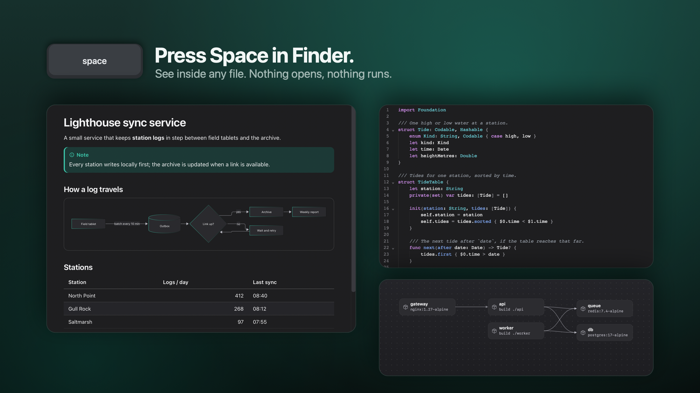
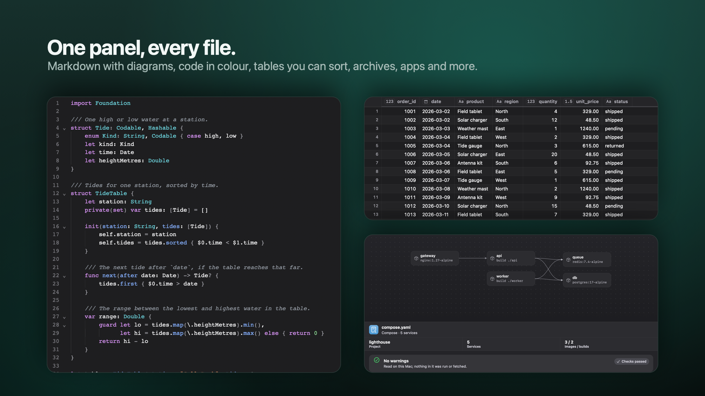
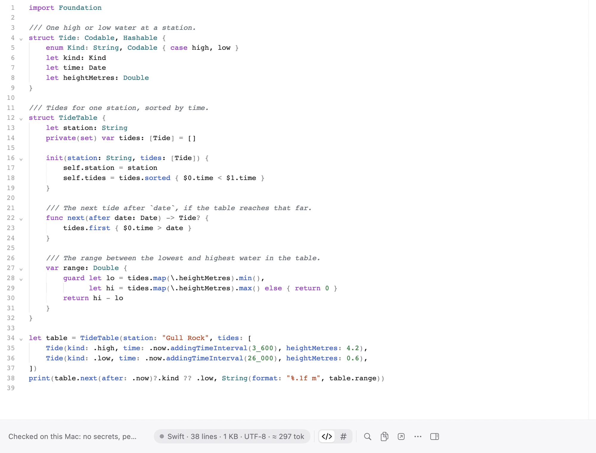
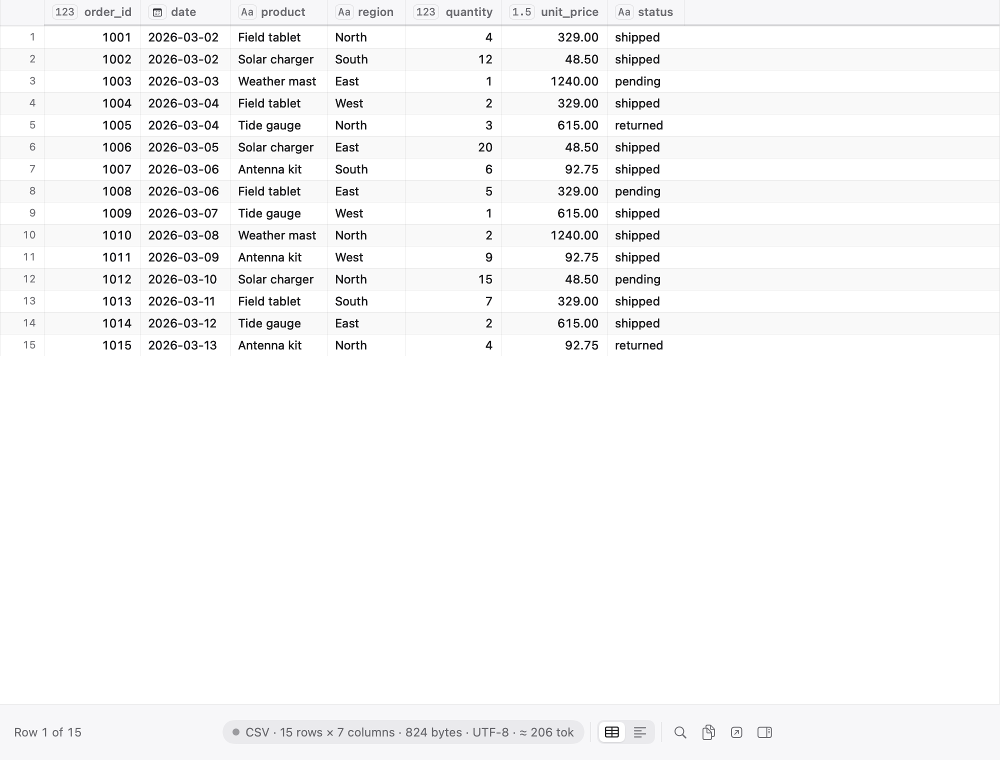
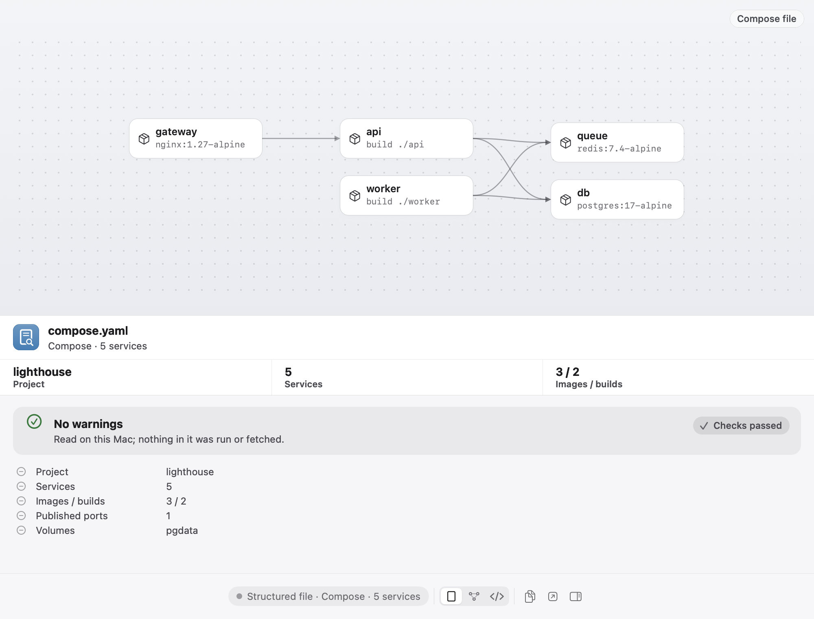
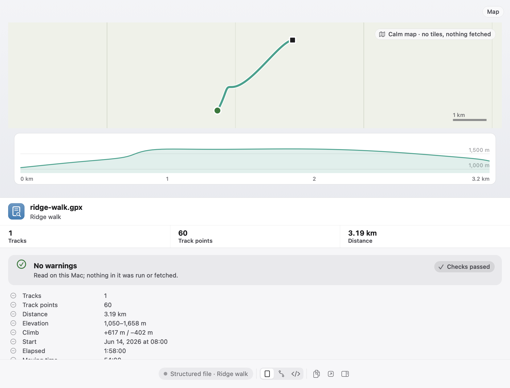
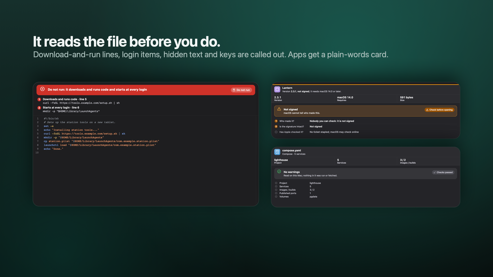
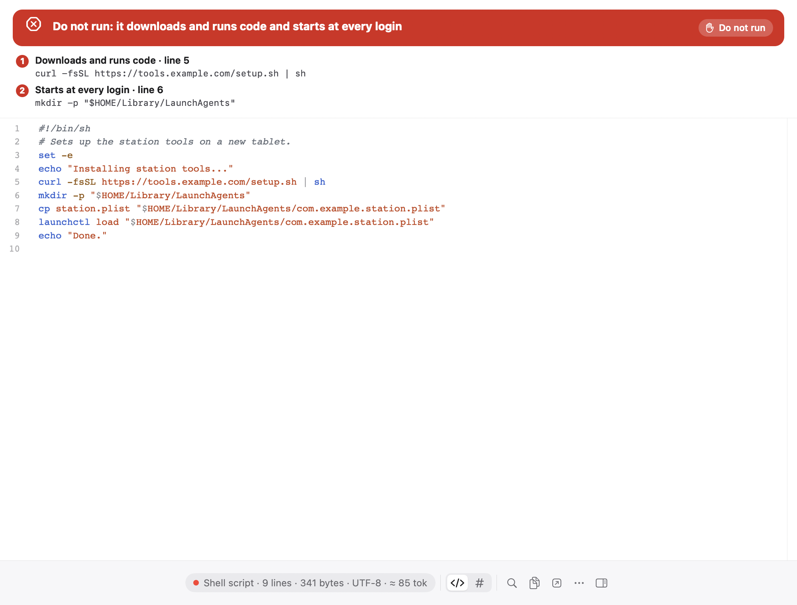
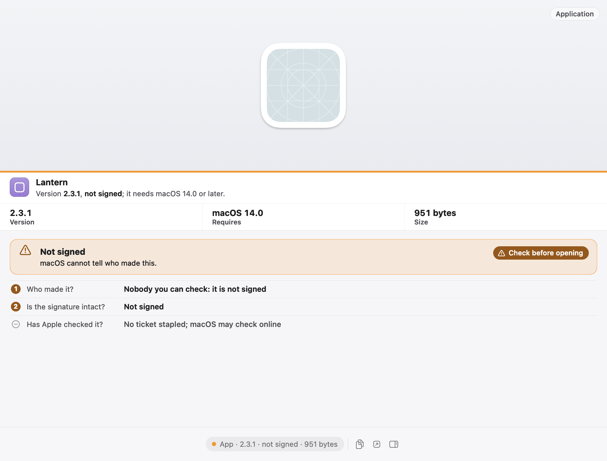

<!-- roadmap: S-17 · DRAFT of the public README. Becomes README.md in the public repository; never published from here. -->
<p align="center"></p>

<h1 align="center">Vitrine</h1>

<p align="center">
  <b>Beautiful file previews.</b><br>
  See inside any file without opening it. A free, open-source Quick Look app for macOS.
</p>

<p align="center">
  <a href="../../releases/latest">Download</a> ·
  <a href="#install">Install</a> ·
  <a href="#privacy">Privacy</a> ·
  <a href="#build-from-source">Build from source</a> ·
  <a href="#faq">FAQ</a>
</p>



Press Space on a file in Finder and macOS often shows a grey icon or a wall of plain text. Vitrine draws it
properly: Markdown with its diagrams and maths, source code in colour, tables you can sort, databases you can query,
archives you can look into, and a plain-words card for apps and installers that says whether they are safe to open.

It never changes a file, never runs anything in it, and reads everything on your Mac.

*Every file in these pictures is made up.*

## What it previews



| family | what you see |
|---|---|
| **Markdown** | Rendered with a contents column, Mermaid diagrams, KaTeX maths, callouts, task lists, footnotes and front matter; wikilinks, ==highlights==, sub- and superscript; a rendered / source switch. |
| **Code** | Hundreds of languages in colour, line numbers, folding, find, indent guides; logs with level colours; JSON, YAML, TOML, XML and property lists as trees, with jq queries. |
| **Data** | CSV and TSV as sortable tables with a column profile; SQLite with a read-only SQL box; Parquet, Arrow, Feather, Excel workbooks and JSON Lines. |
| **Diffs and compares** | Patches and diffs side by side or inline; select two files to compare text, JSON, notebooks or images. |
| **Archives** | zip, tar and its compressed forms, 7z, RAR, xz, zstd, lz4, JAR, DEB, RPM, XAR, ISO and disk images, with sizes, and warnings for paths that escape or programs inside. |
| **Apps, installers, disk images** | Who made it, whether the signature holds, whether Apple checked it, where it was downloaded from, and what it may use, in plain words. |
| **Folders** | Total size, the largest items, a breakdown by kind; Git repositories show the branch, recent commits and uncommitted changes. |
| **Notebooks** | Jupyter `.ipynb` with outputs and images, and marimo notebooks. |
| **AI and agent files** | Claude Code and Codex sessions as a conversation, with what the agent changed; rules files (CLAUDE.md, AGENTS.md, SKILL.md and others); MCP configs ("what will run on your Mac"); model headers (GGUF, safetensors, tokenizer.json, ONNX, Core ML); a token count on every text file. |
| **Engineering files** | OpenAPI, GraphQL, protobuf and JSON Schema; Compose and GitHub Actions as graphs; Kubernetes, Terraform state, Dockerfiles, HAR waterfalls; certificates and keys; lockfiles; Xcode string catalogs, asset catalogs and crash reports. |
| **Everyday files** | Maps (GPX, KML, GeoJSON) with elevation, 3D models, audio with a waveform, subtitles, EPUB and comics, email, calendar invites and contacts, LaTeX and BibTeX, images with their details, fonts. |

<table>
  <tr>
    <td width="50%">
      <picture>
        <source media="(prefers-color-scheme: dark)" srcset="docs/media/code-dark.png">
        
      </picture>
      <p align="center"><sub>Code</sub></p>
    </td>
    <td width="50%">
      <picture>
        <source media="(prefers-color-scheme: dark)" srcset="docs/media/csv-dark.png">
        
      </picture>
      <p align="center"><sub>A CSV file as a table</sub></p>
    </td>
  </tr>
  <tr>
    <td width="50%">
      <picture>
        <source media="(prefers-color-scheme: dark)" srcset="docs/media/compose-dark.png">
        
      </picture>
      <p align="center"><sub>A Compose file as a service graph</sub></p>
    </td>
    <td width="50%">
      
      <p align="center"><sub>A GPX track, drawn without map tiles</sub></p>
    </td>
  </tr>
</table>

In the Space panel macOS keeps a few types for its own previewers (CSV, SVG, fonts and photos among them). Vitrine
shows those in its own window: `vitrine orders.csv`, or Open With › Vitrine.

## The trust lens



<p align="center">
  <picture>
    <source media="(prefers-color-scheme: dark)" srcset="docs/media/trust-lens-dark.png">
    
  </picture>
</p>

Every text preview is read for things that should make you stop before you run or share a file:

- **Dangerous scripts.** Download-and-run lines, hidden base64 blobs, and scripts that install themselves to start at
  every login, each pointed out by line.
- **Secrets.** API keys, tokens, passwords and private keys are found by 84 detectors and masked in the preview; the
  banner gives counts, never the values.
- **Hidden Unicode.** Invisible characters and look-alike letters, loudest in rules files and configs, where they are
  used to slip instructions past a reader.
- **Apps, installers and disk images.** Who signed it, whether the signature is intact, whether Apple notarized it,
  where it was downloaded from, whether macOS will open it, and what it may use (camera, location, files). An
  installer's scripts are readable, and a dangerous one turns the card red with "Do not install".
- **Archives.** Paths that would escape the folder, programs inside, encrypted members, archives within archives.

When a file is clean you get one calm line: "Checked on this Mac: no secrets, personal details or hidden text".

<p align="center">
  <picture>
    <source media="(prefers-color-scheme: dark)" srcset="docs/media/app-card-dark.png">
    
  </picture>
</p>

## The helper, and what it will not do

Quick Look previews run in Apple's sandbox, which keeps them from opening anything. A small background helper,
VitrineHelper, does the few things a preview needs beyond that: Open in…, Reveal in Finder, open a link, open a file
at a line in your editor, extract one file from an archive, and the on-device summary. It follows fixed rules:

- It answers only Vitrine's own previews (it checks each caller's code signature).
- **It never runs anything.** It opens a file only with an app macOS lists for that file, and never if the file is a
  program, script, installer or app.
- Links open only if they are `http`, `https` or `mailto`, in your own browser, after you click them.
- "Open at line" works only for an existing file and only in VS Code, Cursor, Zed or Xcode, when installed.
- Extracting writes one regular file to your Downloads folder under a new name, marks it as downloaded (so macOS
  checks it before it can run), shows it in Finder and never opens it. Paths that try to leave the archive are refused.
- The summary sends at most 24,000 characters of text to Apple's on-device model, only when you have turned on
  Settings › Privacy › Offer on-device summaries. Nothing leaves the Mac.

macOS lists the helper with Vitrine in System Settings › General › Login Items & Extensions.

## Privacy

Vitrine has no account, no analytics, no telemetry and no crash reporting. Previews are drawn in pages that cannot
reach the network at all. What can leave your Mac is exactly this, and each one starts with something you do:

- **Vulnerability lists, if you turn them on.** In Settings › Privacy you can pick package ecosystems (npm, PyPI,
  Cargo, Go, Ruby, PHP, Swift). Vitrine then downloads OSV's whole public advisory list for each one you picked, so
  lockfile previews can flag known vulnerabilities. Your package names are never sent. Off by default.
- **Links you click.** A link in a preview opens in your browser when you click it; nothing is fetched before that.
- **Images you ask for.** A Markdown file's web images (badges, screenshots) are not loaded. A bar offers
  "Load once"; on that click Vitrine fetches only those images, for that one view, and remembers nothing.
- **Update checks.**
  Vitrine checks for a new version at most once a day, or when you choose Check for Updates…, by fetching one small
  signed file. No identifiers are sent. You can turn it off in Settings › About. See [Updates](#updates).

The Claude connector (below) talks to Claude through a local pipe on your Mac; what Claude does with the answers is
up to the Claude app or Claude Code you connected it to.

## Requirements

- macOS 15 Sequoia or later
- Apple silicon or Intel (one universal app)

## Install


1. Download `Vitrine-<version>_<build>.dmg` from the [latest release](../../releases/latest).
2. Open it and drag Vitrine to your Applications folder.
3. Open Vitrine. macOS says it cannot verify the developer: click **Done** (not Move to Trash).
4. Open **System Settings → Privacy & Security**, scroll to the message about Vitrine, click **Open Anyway** and
   confirm with your password or Touch ID. macOS remembers this; updates do not ask again.
5. Vitrine's welcome window lists each preview extension and whether macOS is using it. If one shows as off, turn it on
   in **System Settings › General › Login Items & Extensions › Quick Look**.
6. Select a file in Finder and press Space.

**Why the warning?** Vitrine is signed with its own certificate rather than an Apple Developer ID, because it is a
free project without a paid Apple developer account. The signature still guarantees that every release and update
comes from the same signer (Vitrine checks that itself before installing an update); macOS simply has no Apple record
of who that signer is. If you would rather not take that on trust, build it yourself from this repository (below).

Keep the app in one place, such as Applications: the update check will not install over a copy that runs from the
disk image or from a temporary location.

If a file still opens in Apple's previewer, open Diagnostics (Settings › General): it shows which app answers for each
file type and offers a fix when another app wins.

## Updates


Vitrine checks for a new version at most once a day (Settings › About), or when you choose **Check for Updates…**. It
fetches one small signed file and nothing else; when you press **Install** it downloads the disk image. No identifiers
are sent.

Before anything is replaced:

- the update file must carry a valid **Ed25519 signature** from Vitrine's update key, whose public half is built into
  the app (HTTPS only; a redirect to another host is refused);
- the version must be newer than yours (no downgrades) and support your macOS;
- the downloaded disk image must match the **size and SHA-256** the signed file names;
- the app inside must pass macOS's **code-signature check against the signer of the copy you run** and use the
  hardened runtime;
- only then is the app swapped in one step, with the previous copy kept until the new one has started and put back
  if macOS will not open it.

If any check fails, your installed Vitrine is left exactly as it was and the alert says why. There is no third-party
update framework in the app. A copy you built yourself (ad-hoc signed) cannot verify updates; download new versions
by hand.

## Settings

- **General.** The metadata strip and its facts, the menu bar icon, Claude Code and Codex session tracking, the
  `vitrine` command, the Claude connector, exact OpenAI token counts, and Diagnostics.
- **File Types.** Which previewer answers for each type, what a file opens as (rendered, source, table, tree), and
  Finder thumbnails for text files.
- **Appearance.** Accent colour, the Markdown theme (15 built in) and text size, the code font and size.
- **Markdown.** Diagrams, the contents column, front matter, maths, emoji shortcodes, smart punctuation, image width.
- **Code.** Code theme, line numbers, wrapping, tab width, sticky scope headers, indent guides, changed lines from Git,
  minimap.
- **Folders.** Folder contents drawn on the Finder icon, for the folders you choose.
- **Privacy.** Recent previews, on-device summaries, vulnerability lists and how often they refresh.
- **About.** Version, update checks, credits for the vulnerability data and the OpenAI token counts, and how to
  report a problem.

Vitrine is in English, German, French, Japanese and Korean.

## The command line

Settings › General › The vitrine command puts a `vitrine` command on your path (it shows the one line it runs
first).

```sh
vitrine notes.md data.csv              # open files as tabs in the Vitrine window
vitrine open --float build.log         # a small window kept on top
vitrine open --new-window -g *.json    # a new window, left behind the app you are in
vitrine compare old.json new.json      # compare two files side by side
```

Vitrine shows files; it never changes them.

## Claude connector

`vitrine mcp` lets Claude look at files the way Vitrine does, with four read-only tools:

| tool | what it answers |
|---|---|
| `describe_file` | what the file is, in a few facts |
| `render` | the file as Vitrine reads it, as text or as a picture of the preview |
| `scan_secrets` | the secrets in it, masked unless the call asks for them |
| `token_count` | its size in tokens |

Each call runs in a fresh worker with the previews' own readers, so a hostile file cannot take the connector down,
and nothing in a file is ever run. Connect it in **Settings › General › Claude connector**: **Connect…** for Claude
Code runs `claude mcp add --scope user vitrine -- <Vitrine.app>/Contents/Helpers/vitrine mcp` (shown before it runs);
for the Claude app it adds one entry to the Claude app's settings file, shown before it is written. Disconnect is
the same button.

## Build from source

You need Xcode 27 or later (Swift 6) and [XcodeGen](https://github.com/yonaskolb/XcodeGen).

```sh
git clone https://github.com/XBTDMT/vitrine.git
cd vitrine

brew install xcodegen
xcodegen generate --spec app/project.yml

# The app, ad-hoc signed (no certificate needed).
xcodebuild -project app/Vitrine.xcodeproj -scheme Vitrine -configuration Debug \
  -derivedDataPath app/build/DerivedData build CODE_SIGN_IDENTITY=- DEVELOPMENT_TEAM=

# The full test suite.
xcodebuild -project app/Vitrine.xcodeproj -scheme Vitrine \
  -derivedDataPath app/build/DerivedData test CODE_SIGN_IDENTITY=- DEVELOPMENT_TEAM=
(cd app/Packages && swift test)
```

The app is `app/build/DerivedData/Build/Products/Debug/Vitrine.app`. Move it to Applications and open it once so
macOS finds its extensions.

A build from source differs from a release in two ways: it cannot verify updates (there is no stable signer to compare
against), and the helper's actions (Open in…, Reveal,
extract, the summary) stay off, because the helper answers only callers signed with the same certificate as itself,
and an ad-hoc build has no certificate.

`Vitrine --snapshot <file> <out.png> [dark]` draws a preview off-screen into a PNG; the pictures in this README were
made that way.

The web libraries in `app/VitrinePreviewKit/Resources/web/` are committed so a clone builds offline;
`app/tools/vendor_web.sh` re-creates them at their pinned versions.

## Releasing (maintainer)

On the release Mac only (it holds the release certificate and the update key):

1. Once: create the **Vitrine Self-Signed** code-signing certificate (Keychain Access → Certificate Assistant →
   Create a Certificate, type Code Signing), and the update key with
   `vitrine-release keygen --key-item "Vitrine update key" --backup-to /Volumes/<encrypted backup>/vitrine-update-key.b64`
   (try `--dry-run` first). The public half goes into `VITRINE_UPDATE_PUBLIC_KEY` in `app/project.yml`, next to
   `VITRINE_UPDATE_FEED_URL = https://xbtdmt.github.io/vitrine/vitrine-update.json`.
2. `app/scripts/bump-version.sh <version> --commit`, then `app/scripts/make-dmg.sh`: a clean universal Release build,
   signed inside-out, gated by `app/scripts/check-app-signature.sh`, written to `build/dist/Vitrine-<version>_<build>.dmg`.
3. `VITRINE_UPDATE_PUBLIC_KEY=<base64> app/scripts/check-app-signature.sh build/release/Vitrine.app --release`. It
   refuses an ad-hoc signature, a public key other than the one given, a placeholder feed address, and a bundle that
   names the build Mac's folders.
4. `VITRINE_UPDATE_KEY_ITEM="Vitrine update key" app/tools/make-feed.sh build/release/Vitrine.app build/dist/<dmg> https://xbtdmt.github.io/vitrine/releases/<dmg>`.
5. Publish the DMG and `dist/vitrine-update.json` on GitHub Pages at those addresses (the DMG must be served without a
   redirect to another host), and attach the same DMG to the GitHub Release for manual downloads.

## Uninstall

1. Quit Vitrine from its menu bar icon.
2. Move Vitrine from Applications to the Trash. Its extensions, helper and Spotlight importer are inside the app.
3. To remove its settings and data too, delete the folders whose names begin with `io.github.xbtdmt.vitrine` in
   `~/Library/Containers` and `~/Library/Group Containers`.
4. If you connected the Claude connector, remove it first in Settings, or later with `claude mcp remove vitrine -s user`.

## FAQ

**Does it change my files?**
No. Every reader is read-only, and nothing in a file is ever run.

**Why does a CSV or SVG still show Apple's preview?**
macOS keeps a few types for its own previewers in the Space panel. Open them in the Vitrine window instead.

**Is my code or data sent anywhere?**
No. See [Privacy](#privacy) for the short, complete list of what can leave your Mac, each started by you.

**Are the token counts exact?**
For OpenAI models (o200k) yes, and for an open-weight model when its `tokenizer.json` sits next to the file. Claude's
tokenizer is not public, so the Claude count is an estimate and says so.

**Is it free?**
Yes, and it will stay free and open source.

## Contributing

Issues and pull requests are welcome. A few house rules:

- Every sample, fixture and picture must be made up: no real keys, names or files.
- Readers are read-only and bounded on huge or hostile files; they never start a process.
- Swift 6 with strict concurrency; the libraries live in `app/Packages` and are tested without the UI.
- Made-up keys live only in the test folders, which GitHub's secret scanning skips (`.github/secret_scanning.yml`).
  `app/scripts/scan-fixtures-for-real-secrets.sh` checks this in CI: token-shaped text may live only in those trees.
- Run the full test suite (above) before opening a pull request.

## License

Vitrine is free software under the [Mozilla Public License 2.0](LICENSE). Changes to Vitrine's own files must stay
under the same licence when you share them; you may combine Vitrine with other code under other terms.

Third-party components and their licences are listed in [THIRD_PARTY_NOTICES.md](THIRD_PARTY_NOTICES.md).

## Credits

Made by [XBTDMT](https://github.com/XBTDMT).

Built on KaTeX, Mermaid, CodeMirror, Shiki, cmark-gfm, Zstandard and LZ4, with emoji names from gemoji and
vulnerability data from OSV.dev; their licences are in [THIRD_PARTY_NOTICES.md](THIRD_PARTY_NOTICES.md).
